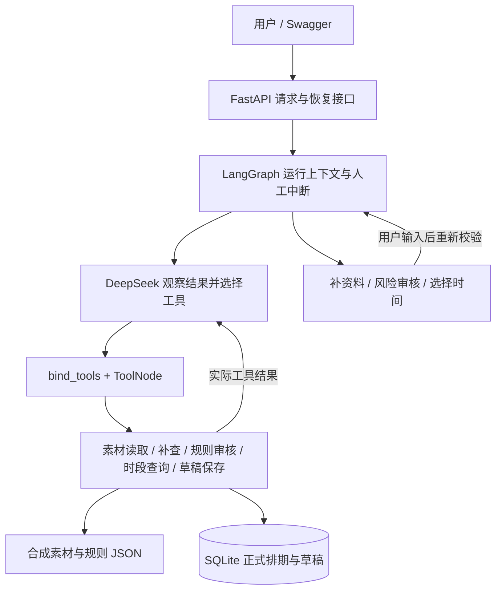

# 素材审核与发布排期 Agent

面向内容团队的单 Agent 项目：读取素材、审核规则、查询排期、处理冲突并保存草稿。支持资料补充、风险人工审核和时间选择三类中断；只保存草稿，不执行发布。

技术栈：Python、LangGraph、LangChain 工具调用、DeepSeek、FastAPI、Pydantic、SQLite、pytest。框架版本及职责见 [方案文档](docs/02-solution.md)。

## 架构



模型选择动作，确定性服务执行审核、计算候选、校验硬性要求与实际保存。时间候选来自服务，审核通过和草稿保存以工具结果为准；明确禁止的内容无法通过人工确认绕过。

## 快速启动

已在 Windows / Python 3.12.4 验证，依赖锁定在 requirements.txt。在项目根目录执行：

```powershell
python -m venv .venv
.\.venv\Scripts\python.exe -m pip install -r requirements.txt

# 无需密钥：启动独立 FastAPI，实际演示正常请求和时间冲突
.\.venv\Scripts\python.exe -X utf8 examples/verify_key_paths.py --cases normal conflict_stale
```

脚本默认使用离线测试模型，在空闲端口启动真实 Uvicorn，使用未来日期、独立合成资料和临时数据库，结束后打印记录目录并关闭演示服务。

要使用 Swagger，在另一个窗口启动常规服务：

```powershell
$env:MATERIAL_AGENT_API_OFFLINE="true"
.\.venv\Scripts\python.exe -X utf8 -m uvicorn src.api:app --host 127.0.0.1 --port 8000
```

打开 http://127.0.0.1:8000/docs。接口为 `POST /schedule`、`GET /runs/{run_id}`、`POST /runs/{run_id}/resume`、`GET /drafts/{request_id}`。
停止离线服务后可用 `Remove-Item Env:MATERIAL_AGENT_API_OFFLINE` 清除临时设置。

真实模型：首次使用参考 [.env.example](.env.example) 创建本地 .env，填写 DeepSeek 地址、模型和密钥；已有 .env 保留。然后运行：

```powershell
# 明确调用真实模型；读取 .env，使用独立演示服务
.\.venv\Scripts\python.exe -X utf8 examples/verify_key_paths.py --live --cases normal conflict_stale
```

常规服务使用 `MATERIAL_AGENT_API_OFFLINE=false` 后按上面的 Uvicorn 命令启动。配置缺失会报错，不自动降级。密钥、虚拟环境和运行数据库均不提交。
Linux/macOS 将 Python 路径改为 `.venv/bin/python`；具体安装、CLI 和环境配置见 [使用说明](docs/usage.md)。

## 核心演示

| 步骤 | 可见结果 | 负责模块 |
| --- | --- | --- |
| 正常素材、原时间可用 | 审核通过，实际保存一份草稿 | Agent 选择工具，审核与保存服务校验 |
| 18:00 被占用 | waiting_for_human，返回 19:00 / 20:00 候选，不新建草稿 | 时段服务计算，LangGraph 中断 |
| 用户选择前，演示夹具把 19:00 设为占用 | 选择 19:00 后重新中断，旧中断 ID 被拒绝 | 保存服务复查占用、运行管理校验 ID |
| 用户选择最新可用时间 | 重新校验后保存，原 18:00 要求仍保留 | 恢复节点与 SQLite 事务 |
| 自动补查仍缺信息 / 授权存疑 | 等待补资料 / 人工通过、驳回或要求修改 | 资料与风险中断节点 |

完整讲解、Swagger 手动步骤和模块对应见 [演示指南](docs/demo.md)。占用变更与工具故障属于明确标注的合成验收操作，生产 HTTP 接口不提供故障注入参数。

## 验证结果

- **324 项自动化测试通过**：[原始输出](examples/test-results.txt)、[逐项报告](examples/test-results.xml)。
- 七类九步业务回放，覆盖正常、信息缺失、规则风险、时段冲突、重复提交、保存失败和无可用时段：[索引](examples/validation-manifest.json)。
- **新增真实 DeepSeek 验收 12/12 通过**：六类各两次，包含冲突及时间失效、补查后重审、人工补资料、人工风险通过和工具错误后停止；共 62 次模型调用、58 次模型工具调用。[实际记录](examples/04_time_conflict/live-key-paths/summary.md)、[评估说明](docs/03-evaluation.md)。工具错误用例以正确失败并停止为通过标准；该比例仅描述本批合成样本。
- 最初两条真实反馈循环也保留：[通过后查询](examples/01_normal/live/summary.md)、[缺失后补查](examples/02_missing_metadata/live/summary.md)。
- 各次运行保存实际 HTTP 输入/输出、工具参数与返回、模型后续动作和公开 reason；不导出内部思维过程。程序中断与复查单独标明，不冒充模型决策。

```powershell
.\.venv\Scripts\python.exe -X utf8 -m pytest -q -W error
.\.venv\Scripts\python.exe -X utf8 examples/record_validation.py
# 六类真实关键路径各运行两次；全部尝试计入结果
.\.venv\Scripts\python.exe -X utf8 examples/verify_key_paths.py --live --repeats 2
```

当前为单进程笔试项目：InMemorySaver 保存待办，重启后需重新提交；SQLite 草稿保留。默认每个运行最多 12 次模型调用，跨人工恢复累计，超限返回 incomplete/LIMIT_EXCEEDED。草稿不预留正式时段，人工审核身份由调用方填写，未实现登录鉴权或真实版权核验。

## 评审材料

| 内容 | 入口 |
| --- | --- |
| 用户、目标、范围和成功标准 | [01-requirements.md](docs/01-requirements.md) |
| 流程、动态决策和设计取舍 | [02-solution.md](docs/02-solution.md) |
| 实际测试、成功率、失败和限制 | [03-evaluation.md](docs/03-evaluation.md) |
| AI 辅助及个人参与说明 | [04-ai-usage.md](docs/04-ai-usage.md) |
| 难点、收获和下一步 | [05-retrospective.md](docs/05-retrospective.md) |
| 演示与接口使用 | [demo.md](docs/demo.md)、[http-api.md](docs/http-api.md) |
| 实际输入、输出和 Trace | [examples/README.md](examples/README.md) |

合成资料位于 [data/api-data.json](data/api-data.json)。更完整的业务约定、离线与真实验证边界见 [业务文档](docs/business-spec.md)、[验证记录](docs/verification.md) 和 [真实 ReAct 验收](docs/react-acceptance.md)。
