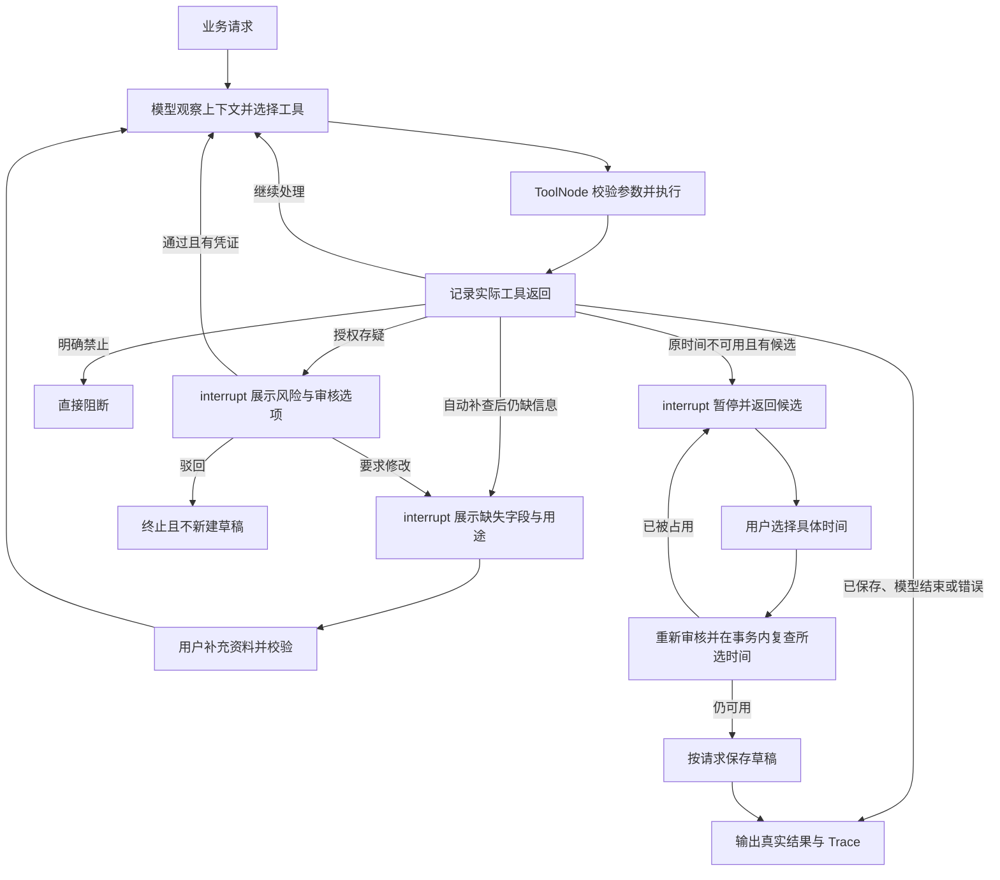

# 02 方案与设计取舍

## 调用流程

HTTP 入口为 [src/api.py](../src/api.py)，命令行入口为 [src/main.py](../src/main.py)。
HTTP 请求绑定服务端素材、规则和数据库，然后由 SchedulingRuns 执行单个 Agent，或等待资料补充、风险审核和时间选择。

模型执行骨架允许条件路由；具体工具调用来自模型响应，而不是预设动作日志。
[workflow.py](../src/agents/workflow.py) 将实际 ToolMessage 送回模型，未完成、错误或调用上限不会被自动补成成功。

## 当前真实验收与动态决策证据

最新批次使用 DeepSeek / deepseek-flash，六类各两次，**12/12 项验收通过**，累计 **62 次模型逻辑调用、58 次模型选择的工具执行**。完整场景和统计见 [评估文档](03-evaluation.md)、[实际汇总](../examples/04_time_conflict/live-key-paths/summary.json)。12/12 仅代表本批合成样本，不代表生产环境成功率或稳定性。

以下动作有实际模型观察和下一轮模型响应，可以作为 ReAct 证据：

| 实际工具观察 | 模型实际选择 | 当前批次证据 |
| --- | --- | --- |
| check_rules=passed | query_slots | [正常 Trace](../examples/04_time_conflict/live-key-paths/normal-1/trace.json) |
| check_rules=needs_info | supplement_material | [补查 Trace](../examples/04_time_conflict/live-key-paths/supplement_success-1/trace.json) |
| supplement_material=ok | check_rules，再观察 passed 后选择 query_slots | [补查后重审 Trace](../examples/04_time_conflict/live-key-paths/supplement_success-1/trace.json) |
| supplement_material=empty | 无后续工具调用，结束并请求补充 | [人工补资料 Trace](../examples/04_time_conflict/live-key-paths/human_metadata-1/trace.json) |
| supplement_material=error | 无后续工具调用，结束；业务返回 TOOL_ERROR | [工具错误 Trace](../examples/04_time_conflict/live-key-paths/tool_failure-1/trace.json) |

每个工具都有 required reason 参数，记录模型给出的简短动作依据。模型的内部 reasoning_content 只由模型集成按协议回传，不导出到交付 Trace。
各轮通过 tool_call_id 对应实际观察与动作；不能只根据最终业务状态认定模型作出了某个决定。

## 人工中断的业务执行证据

时段候选由 SlotSearchService 计算，审核由 RuleService 校验；模型选择业务动作，程序约束事实、权限和保存结果。
以下流程在真实模型服务中实际执行，但暂停、输入校验和事务复查本身由业务代码保证：

| 业务流程 | 已有真实执行证据 | 职责边界 |
| --- | --- | --- |
| 冲突 → 选择前时段失效 → 再次中断 → 重新选择后保存 | [实际 HTTP 与占用事件](../examples/04_time_conflict/live-key-paths/conflict_stale-1/events.json) | 强制暂停、候选计算和所选时间复查属于程序职责，不表示模型自行改选时间 |
| 资料缺失 → 人工补齐 → 同一运行重新审核和保存 | [补资料恢复事件](../examples/04_time_conflict/live-key-paths/human_metadata-1/events.json) | 字段校验和恢复由程序执行；恢复后的工具选择来自模型 |
| 授权存疑 → 有凭证人工通过 → 重新审核和保存 | [风险通过恢复事件](../examples/04_time_conflict/live-key-paths/human_review-1/events.json) | 审核结论由人提交；程序重审，明确禁止项不可人工绕过 |

人工驳回/要求修改、来源变化后的批准失效、保存故障回滚及调用上限仍主要由离线测试覆盖。首批两条真实记录保留为 [历史批次](03-evaluation.md#首批两条真实决策记录历史批次)，不限制当前真实验收范围。
可安装性和暂停恢复另有 [干净环境证据](../examples/04_time_conflict/clean-environment/summary.md)：从远程重新克隆并新建 Python 3.12.4 环境，324 项测试和六类离线 HTTP 演示通过。这批验证不调用外部模型，与上述 12 次真实模型验收分别统计。

## 模块职责与框架使用

以下为实际安装验证版本，完整传递依赖锁定在 requirements.txt，环境快照见 [environment.json](../examples/environment.json)。

| 组件 | 版本 | 本项目使用的功能与职责 |
| --- | --- | --- |
| Python | 3.12.4 | 程序运行、标准库 SQLite、时间与文件读取 |
| Pydantic / pydantic-settings | 2.14.1 / 2.16.1 | 请求和跨状态校验、严格工具参数、环境变量、密钥不导出 |
| LangGraph | 1.2.18 | StateGraph、ToolNode、add_messages、interrupt/Command、内存检查点 |
| langchain-core | 1.7.0 | @tool、BaseTool、AIMessage/ToolMessage 与 Runnable 接口 |
| langchain-deepseek / langchain-openai | 1.1.1 / 1.7.3 | bind_tools、模型调用、工具协议转换；DeepSeek 集成保留推理协议字段 |
| OpenAI SDK | 2.54.0 | LangChain 集成的底层兼容 API 客户端，不手写工具分发 |
| FastAPI / Uvicorn | 0.162.0 / 0.54.0 | HTTP 校验、Swagger 与本地服务 |
| pytest | 9.2.0 | 可执行回归测试与验证材料生成 |

框架承担工具注册、协议解析、消息管理和暂停恢复。项目自行实现的部分是业务规则、候选计算、工具使用顺序约束、保存事务、请求幂等和验收记录。
DeepSeekChatModel 子类只补齐集成库遗漏的 reasoning_content 回传，不重写工具调用协议。

## 数据、事务与确认

- SQLite 只有 scheduled_slots 和 drafts 两张表，后者按 request_id 唯一。
- 正式占用仅在表首次创建时由合成文件导入，服务重启不会覆盖已经维护的占用。
- BEGIN IMMEDIATE 事务内重查正式占用，再计算、写入和提交；成功状态在提交后才返回。
- 原请求按规范化内容比较，用户接受的时间另存入确认结果，不覆盖原始硬性要求。
- 恢复只接受本次中断 ID 和已提供的候选；所选时间失效时再次中断，不能擅自换一个。
- 待确认草稿不预留正式时段。草稿保存成功和未来仍可用是不同事实。
- 人工资料使用 RunMaterialSource 在当前运行内覆盖缺失字段；风险通过需要审核人、说明和凭证，再运行确定性审核，不直接覆盖审核状态。
- 覆盖值和通过结论绑定素材内容指纹；底层素材变化后失效，重新检查新风险。共享素材文件保持原样，成功保存时将有效资料和人工记录写入现有草稿 JSON。
- 请求修改先进入资料补充，再回到审核；驳回只终止当前运行。当前只有授权存疑可复核，明确禁止的规则没有通过入口。

## 取舍

用单 Agent 和确定性工具代替多 Agent；业务规则可独立测试，模型错误与存储错误更容易定位。
用 SQLite 代替独立数据库服务，保持笔试项目容易运行；明确单进程内存恢复限制。
用合成资料替代外部素材平台，补查为可信本地数据读取，不假称实现了外网检索或授权真实性鉴定。
保留离线模式用于业务回归，但只有 mode=api 的实际调用能证明模型执行路径。
不增加不必要的版本历史、前端和通用审批状态机；实际范围由需求决定。

MATERIAL_AGENT_MAX_MODEL_CALLS 默认 12、范围 1–100。每轮至多一个工具，达到上限时 HTTP 返回 409、status=incomplete、LIMIT_EXCEEDED。
同一运行各次人工恢复后的模型调用累计共用预算；model_steps 和 execution_steps 追加记录并标注 cycle，human_actions 保存人工动作。
该计数是逻辑模型调用；底层 SDK 的有限网络重试不作为新的业务决策，也不作为 ReAct 达标证据。

交付目录参考用户指定的 [agent-campus-submission-example](https://github.com/lwz1357/agent-campus-submission-example)，只借鉴材料组织，不以示例的离线 Mock 作为本项目模型决策的达标依据。
